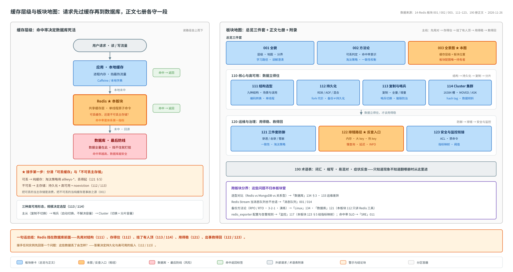

# Redis 全景图

> **这一册回答**：Redis 板块 7 册在缓存层级上的位置，一张图看清。
> **怎么用**：看图定层，再回 [001-Redis全貌](001-Redis全貌.md) 选册。

## 体系一张图

## 图例说明

| 模块 | 册 | 缓存层级段 |
| --- | --- | --- |
| 总览三件套 | 001 / 002 / 003 | 全貌 · 方法论 · 本图 |
| 110-核心与高可用 | 111 / 112 / 113 / 114 | 结构选型 → 持久化 → 复制与哨兵 → Cluster 分片（数据立得住） |
| 120-运维与治理 | 121 / 122 / 123 | 三件套防御 → 排错路径 → 安全与监控衔接（用得稳、救得回） |
| 附录 | 190 | 术语 · 缩写 · 易混对 · 症状反查 |

图中请求自上而下是**读路径**：应用先查缓存，miss 才回源数据库——七册按「先用对（111）→ 存得住（112）→ 挂了有人顶（113/114）→ 用得稳（121）→ 出事救得回（122/123）」组织，告警反查入口在 122。

---

**上一篇**：[002-Redis方法论](002-Redis方法论.md)　**下一篇**：正文 [110-核心与高可用/111-数据结构与场景](110-核心与高可用/111-数据结构与场景.md)
