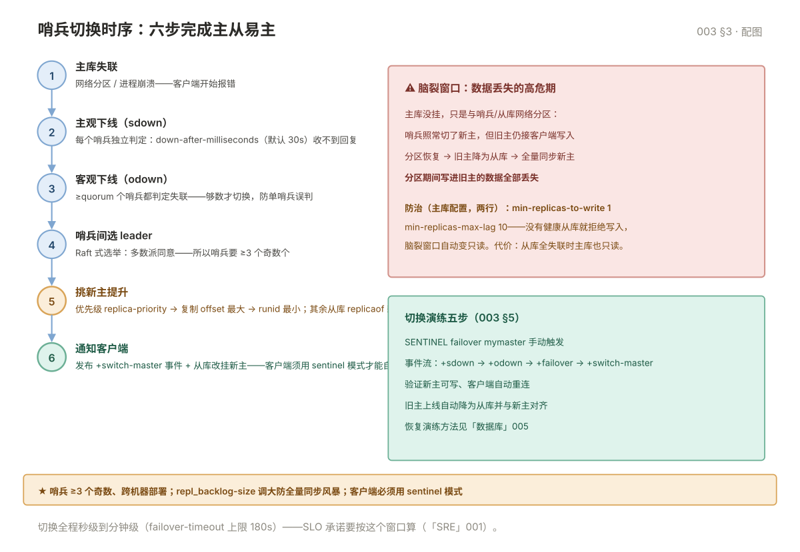

# 003 主从复制与哨兵

> **解决**：一台挂了谁顶上——复制原理、哨兵自动切换、脑裂怎么防。  
> **范围**：复制原理 · 搭建验证 · 哨兵架构与时序 · 脑裂 · 切换演练。  
> **口径**：Redis 7.2（PSYNC2 支持故障转移后增量重连）。

## 目录

| 节 | 内容 |
|---|---|
| 1 | 复制原理：全量与增量 |
| 2 | 搭建与验证 |
| 3 | 哨兵：自动切换 |
| 4 | 脑裂：数据丢失的窗口 |
| 5 | 切换演练与恢复 |
| 6 | 坑表 |
| 7 | 检查清单 |

---

## 1. 复制原理：全量与增量

从库 `REPLICAOF <主> <端口>` 后建立复制链路：

| 阶段 | 机制 | 触发条件 |
|---|---|---|
| **全量同步** | 主库 bgsave 生成 RDB → 全量发给从库 → 缓冲区增量补发 | 首次复制 / repl_backlog 覆盖不到断点 |
| **增量同步** | 从库带上 `replid+offset`，主库从 **repl_backlog**（环形缓冲）补发断点之后的数据 | 断线重连且断点还在缓冲区内 |

运维要点：**repl_backlog-size 是增量命中的关键**——默认 1MB 太小，写入猛的实例断线几秒就"覆盖不到"触发全量（全量 = 又一次 fork + 主从带宽打满）。按"写入速率 × 预期断线时长"估大小，生产建议 ≥64MB。全量同步风暴：多个从库同时断线重连 = 同时全量——错峰重连或用级联复制（从挂从）。

## 2. 搭建与验证

```conf
# 主库 redis.conf（无需特别配置）
# 从库
replicaof 10.0.0.1 6379
```

验证：从库 `INFO replication` 看 `master_link_status:up` 与 `master_repl_offset` 增长；主库看 `connected_slaves` 与各从库 offset。**从库默认只读**（`replica-read-only yes`）——应用别把写打到从库。

## 3. 哨兵：自动切换

哨兵是独立进程（`redis-sentinel`），至少 **3 个、奇数、分布在不同机器**：

```conf
sentinel monitor mymaster 10.0.0.1 6379 2    # 2 = quorum
sentinel down-after-milliseconds mymaster 30000
sentinel failover-timeout mymaster 180000
```

切换流程（哨兵选主时序见下图）：

```plain
主库失联 → 各哨兵独立判定"主观下线"（down-after-ms）
→ ≥quorum 个哨兵确认 → 升级"客观下线"
→ 哨兵间选举 leader（Raft）→ leader 执行切换
→ 挑数据最新的从库提升为新主 → 其余从库 replicaof 新主
→ 通知客户端（pub/sub +__sentinel__:hello 与重连）
```

选新主的三个优先级：**replica-priority**（越小越优先，0 = 永不参与）→ **复制 offset 最大**（数据最新）→ **runid 最小**（兜底）。客户端必须支持哨兵协议（如 Jedis/Lettuce/ioredis 的 sentinel 模式）才能自动发现新主。



## 4. 脑裂：数据丢失的窗口

**场景**：主库没挂，只是与哨兵/从库网络分区——哨兵切了新主，但**旧主还在接收客户端写入**；分区恢复后旧主被降级为从库并**全量同步新主**——分区期间写进旧主的数据**全部丢失**。

防治（主库配置，两者都设）：

```conf
min-replicas-to-write 1     # 至少 1 个从库正常复制才接受写
min-replicas-max-lag 10     # 从库延迟 ≤10s
```

含义：主库发现"没有健康的从库跟得上"就**拒绝写入**——脑裂窗口内旧主自动变只读，丢数据窗口被关掉。代价：全部从库失联时主库也只读——可用性换一致性，主存储业务值得。

## 5. 切换演练与恢复

切换不是天天发生，**演练才能保证真的会切**：

| 步骤 | 动作 | 验证 |
|---|---|---|
| 1 | `SENTINEL failover mymaster` 手动触发 | 从库日志出现 `+switch-master` |
| 2 | 观察哨兵事件流 | `+sdown → +odown → +failover → +selected-slave → +switch-master` |
| 3 | 验证新主可写、客户端已重连 | `INFO replication` 角色翻转 |
| 4 | 旧主重新上线自动变从库 | 数据与新主对齐 |
| 5 | 故障恢复演练 | 按本册流程走一遍全链路（方法见「数据库」005） |

## 6. 坑表

| # | 坑 | 后果 | 正确做法 |
|---|---|---|---|
| 1 | repl_backlog 默认 1MB | 断线秒级触发全量同步风暴 | 按写入速率 × 断线时长调大（≥64MB） |
| 2 | 哨兵只部署 1 个 | 单点 + 无法形成 quorum | ≥3 个奇数、跨机器 |
| 3 | 客户端直连主库 IP | 切换后写全打到已降级的旧主 | 客户端用 sentinel 模式发现主库 |
| 4 | 没配 min-replicas-to-write | 脑裂丢数据 | 主存储必配（§4） |
| 5 | `replica-priority 0` 设在数据最新的从库 | 它永不参与选主，选出数据落后的 | 0 只给"备份型"从库 |
| 6 | 哨兵与主库同机 | 主机挂了哨兵跟着挂 | 哨兵跨机器部署 |

## 7. 检查清单

| # | 问题 |
|---|---|
| 1 | repl_backlog-size 多大？按什么估的？ |
| 2 | 哨兵几个、部署在哪、quorum 是几？ |
| 3 | 客户端是 sentinel 模式还是写死 IP？ |
| 4 | min-replicas-to-write/max-lag 配了吗？能接受它的可用性代价吗？ |
| 5 | 手动 failover 演练过吗？事件流能背出来吗？ |
| 6 | 脑裂窗口的数据丢失上限算过吗？ |

---

**下一篇**：[004 Cluster 集群](004-Cluster集群.md) —— 数据超单机容量怎么分。
