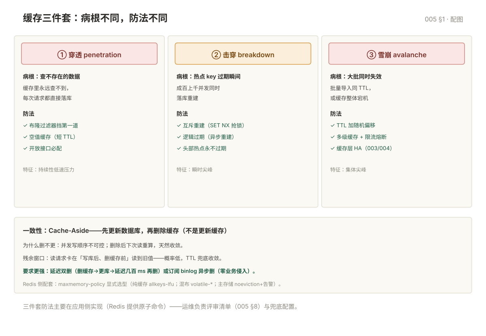

# 005 缓存设计三件套

> **解决**：缓存怎么用不拖垮数据库——穿透/击穿/雪崩的防法、与数据库的一致性、淘汰策略与过期机制。  
> **范围**：三件套总览与各自解法 · 一致性模式 · 淘汰与过期。  
> **口径**：策略由**应用侧**实现为主（Redis 只提供原子命令）——运维负责评审与兜底配置。

## 目录

| 节 | 内容 |
|---|---|
| 1 | 三件套总览：一张对比表 |
| 2 | 穿透：查不存在的数据 |
| 3 | 击穿：热点过期瞬间 |
| 4 | 雪崩：大批失效或宕机 |
| 5 | 淘汰策略与过期机制 |
| 6 | 缓存与数据库一致性 |
| 7 | 坑表 |
| 8 | 检查清单 |

---

## 1. 三件套总览

三件事都会"数据库被缓存绕过直接打穿"，但**病根与防法完全不同**：

| | 穿透 | 击穿 | 雪崩 |
|---|---|---|---|
| 病根 | 查**不存在**的数据，缓存永远为空 | **一个热点 key** 过期瞬间并发涌入 | **大批 key 同时失效**或缓存整体宕机 |
| 数据库感受 | 持续性低速压力 | 瞬时尖峰 | 集体尖峰 |
| 防法 | 布隆过滤器 + 空值缓存 | 互斥重建 + 逻辑过期 | 过期时间加随机 + 多级缓存 |



## 2. 穿透：查不存在的数据

恶意请求或 bug 用不存在的 id 反复查库——Redis 里永远查不到，每次都落库。

| 解法 | 做法 | 取舍 |
|---|---|---|
| **布隆过滤器** | 全量 id 预灌；"一定不存在"直接拒绝 | 有误判率，删数据不回缩 |
| **空值缓存** | 查库不存在 → `SET key "" EX 60` | 短 TTL 防内存涨，覆盖多数场景 |

**组合拳**：布隆过滤器挡第一道 + 空值缓存兜底；对开放接口（可被恶意遍历 id）必备。

## 3. 击穿：热点过期瞬间

热点 key（如首页商品）过期瞬间，成百上千并发同时查库——缓存空窗期数据库被打出尖峰。

| 解法 | 做法 | 取舍 |
|---|---|---|
| **互斥重建** | 未命中后先 `SET lock NX EX 10` 抢锁，抢到的查库回填，其余 sleep 重试 | 简单可靠；有等待延迟 |
| **逻辑过期** | value 里带过期时间戳，"过期"后返回旧值 + 异步重建 | 无阻塞；短暂脏数据 |
| **热点永不过期** | 物理不过期，靠逻辑过期管理 | 适合极少数头部热点 |

## 4. 雪崩：大批失效或缓存宕机

大批 key **同一时刻过期**（批量导入用了相同 TTL），或 Redis 整体宕机——数据库瞬间承接全部流量。

| 解法 | 针对 |
|---|---|
| **过期时间加随机**（TTL ± 随机 0~300s） | 大批同时过期 |
| **多级缓存**（应用本地缓存 + Redis） | Redis 层故障时的缓冲 |
| **限流熔断降级** | 缓存整体宕机时的兜底（应用侧） |
| **主从/哨兵/Cluster** | 缓存层自身高可用（003/004） |

## 5. 淘汰策略与过期机制

**过期 ≠ 淘汰**：过期是 key 到了自己 TTL（惰性删除：访问时查；定期删除：后台抽样清理）；淘汰是**内存到顶**后按策略请出未过期的 key。

```conf
maxmemory 6gb
maxmemory-policy allkeys-lfu
```

| 策略 | 行为 |
|---|---|
| **noeviction**（默认） | 到顶**拒绝写入**——报 OOM command not allowed |
| allkeys-lru / allkeys-lfu | 全体 key 按 LRU/LFU 淘汰——**纯缓存首选** |
| volatile-lru/lfu/ttl | 只淘汰**设置了过期时间**的 key——缓存与持久 key 混布时用 |
| allkeys-random / volatile-random | 随机淘汰——一般不用 |

选型：纯缓存用 `allkeys-lfu`（LFU 抗偶发扫描污染）；混布持久 key 用 `volatile-*`；**主存储 Redis 用 noeviction + 容量告警**——宁可报错不许静默丢数据。

## 6. 缓存与数据库一致性

主流模式 **Cache-Aside**：读——先缓存、未中查库回填；写——**先更新数据库、再删除缓存**（不是更新缓存）。为什么"删"而不是"更"：并发写时更新的顺序不可控，删除下次读会重算，天然收敛。

残余不一致窗口：读请求在"写库后、删缓存前"读到旧值——概率低、靠 TTL 兜底收敛。要求更强时：

| 方案 | 做法 | 代价 |
|---|---|---|
| 延迟双删 | 删缓存 → 更新库 → 延迟几百 ms 再删一次 | 覆盖并发读回填的脏窗口 |
| 订阅 binlog | CDC（如 Canal）异步删缓存，业务零侵入 | 引入中间件与延迟 |
| 强一致双写 | 分布式事务包裹 | 性能代价大，缓存场景几乎不用 |

## 7. 坑表

| # | 坑 | 后果 | 正确做法 |
|---|---|---|---|
| 1 | 批量导入用相同 TTL | 到点集体失效 = 定时雪崩 | TTL 加随机偏移 |
| 2 | 默认 noeviction 直接上生产 | 内存到顶全量写失败 | 显式设策略 + 容量告警 |
| 3 | 更新库后"更新缓存" | 并发写顺序错乱，脏数据长期留存 | 改为删除缓存 |
| 4 | 只防了穿透没防击穿 | 头部热点过期瞬间打挂库 | 热点 key 互斥重建 |
| 5 | 缓存与库混布还用 allkeys-lru | 持久 key 被静默淘汰 | volatile-* 或分开实例 |

## 8. 检查清单

| # | 问题 |
|---|---|
| 1 | 三件套的病根能一句话区分吗？ |
| 2 | 开放接口的穿透防线（布隆/空值）上了吗？ |
| 3 | 头部热点 key 有互斥重建吗？ |
| 4 | TTL 有随机偏移吗？ |
| 5 | maxmemory-policy 是显式选的哪个？为什么？ |
| 6 | 写路径是"删缓存"还是"更缓存"？能说出为什么吗？ |

---

**下一篇**：[006 运维实战与排错](006-运维实战与排错.md) —— 内存、大 key、慢查询与延迟的排查路径。
