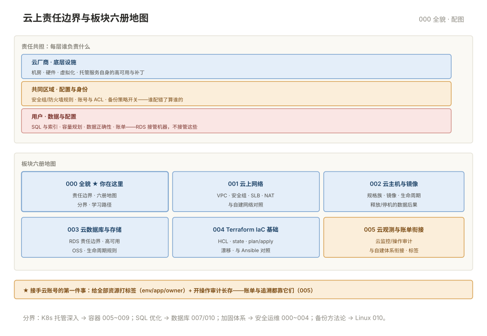

# 000 云计算全貌

> **这一册回答**：云平台板块管什么、上云后运维的角色变成什么、六册怎么分工。10 分钟读完装进一张地图。  
> **给谁读**：要上云、已上云、负责云资源的运维/SRE。位于五阶段第三段（平台与交付）。

## 板块地图

六册一条主线：**网络打底（001）→ 主机交付（002）→ 数据托管（003）→ 代码化管理（004）→ 观测与成本收口（005）**。

| 册 | 一句话 | 回答的问题 |
|---|---|---|
| [001 云上网络](001-云上网络.md) | VPC 是云上一切的底座 | VPC/安全组/SLB/NAT 怎么搭，与自建防火墙的对照 |
| [002 云主机与镜像](002-云主机与镜像.md) | ECS 的完整生命周期 | 选型、镜像、登录、释放——什么状态会丢数据 |
| [003 云数据库与存储](003-云数据库与存储.md) | 托管服务接管了什么 | RDS/OSS 的责任边界、备份与生命周期 |
| [004 Terraform IaC 基础](004-TerraformIaC基础.md) | 资源用代码管 | HCL/state/plan-apply，为什么永远先 plan |
| [005 云观测与成本](005-云监控云日志与衔接.md) | 云产品与自建体系怎么衔接 | 云监控/操作审计/账单分账 |
| [00 术语表](00-术语表.md) | 词汇 · 缩写 · 易混对 · 症状反查 | 按主题分组 |

云上责任边界与六册位置：

## 核心概念速览

- **责任共担是主线**：云厂商接管"机器与底层"，你保留"数据、配置、SQL、容量"——每册都在划这条线（001 网络策略/003 数据/005 账单）。
- **区域与可用区**：region 是城市，AZ 是城内机房——高可用的最小跨度是"跨 AZ 部署"，跨 region 是容灾。
- **一切皆可 API**：控制台只是 API 的皮——运维要坚持 CLI/API/IaC，才能进流水线（004）。
- **IaC 改变交付方式**：资源从"点点点"变成"代码评审+plan 预览"——漂移（drift）是最大敌人（004）。
- **按量计费是双刃剑**：灵活但泄漏快——账单分账与资源标签从第一天就要做（005）。

## 与相邻板块的分界

| 问题 | 去哪 |
|---|---|
| K8s 托管版（ACK/EKS）的深入 | 「容器」005~009——本板块只讲"云上 K8s"的形态 |
| 数据库选型与 SQL 优化 | 「数据库」009/010——本板块 003 只讲托管形态 |
| 自建监控体系（Prometheus 全套） | 「监控」板块——本板块 005 只讲云产品衔接 |
| 安全加固与等保的完整体系 | 「安全运维」016——本板块只讲安全组与网络层 |
| 云厂商 CLI 的完整命令手册 | 以官方文档为准——本册给概念与最常用命令 |

## 学习路径

- **顺序读**：000 → 001 → 002 → 003 → 004 → 005。
- **已有自建经验者**：重点读 000（责任边界）与 001（网络对照），002~003 按需查。
- **按任务进**：搭 VPC → 001；开通数据库 → 003；资源用代码管 → 004；账单异常 → 005 §4。

## 误解澄清

| # | 误解 | 事实 |
|---|---|---|
| 1 | 上云 = 不用运维了 | 接管的是机器与底层；SQL/容量/数据正确性/账单全是你 |
| 2 | 云上资源随便删随便建 | 没有操作审计与标签的账号，泄漏与误删都追不回（005） |
| 3 | 可用区是同一机房 | AZ 是物理隔离机房——同 AZ 部署等于放弃高可用 |
| 4 | IaC 是开发的事 | 运维不掌握 IaC，云资源就永远不可评审不可重建 |
| 5 | 按量计费比包年便宜 | 测试与突发按量友好；长期稳态负载包年低数倍 |

---

**下一篇**：[001 云上网络](001-云上网络.md) —— VPC 是一切云资源的底座。
