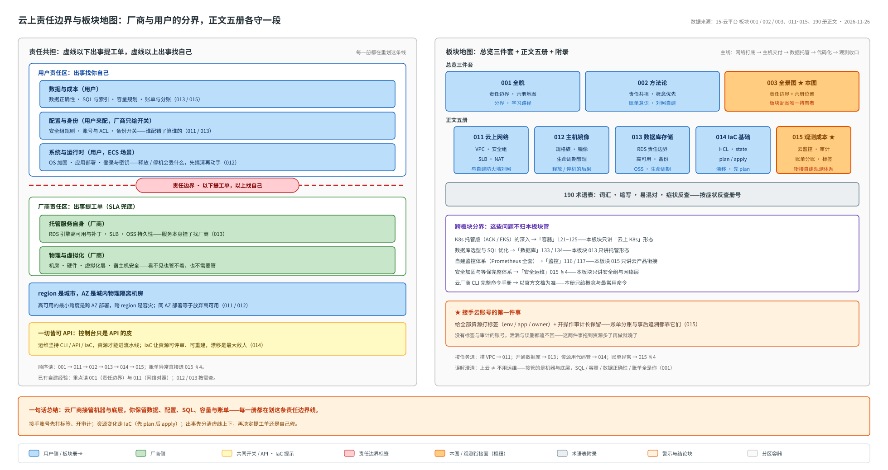

# 云全景图

> **这一册回答**：云平台板块 5 册在责任边界上的位置，一张图看清。
> **怎么用**：看图定层，再回 [001-云计算全貌](001-云计算全貌.md) 选册。

## 体系一张图

## 图例说明

| 层 | 册 | 责任边界段 |
| --- | --- | --- |
| 总览三件套 | 001 / 002 / 003 | 全貌 · 方法论 · 本图 |
| 网络层 | 011 | VPC/子网/安全组/SLB——规则的规则在用户侧 |
| 计算层 | 012 | ECS 选型与生命周期——底层归厂商，系统归用户 |
| 数据层 | 013 | RDS/OSS——引擎归厂商，SQL 与备份策略归用户 |
| 资源层 | 014 | Terraform IaC——把资源与责任写进代码 |
| 观测层 | 015 | 云监控云日志与账单——自建体系的衔接面 |
| 附录 | 190 | 术语 · 缩写 · 易混对 · 症状反查 |

图中虚线是**责任边界**：虚线以下（物理层、虚拟化层）出事找厂商工单，虚线以上（系统、数据、配置）出事找你自己——五册按层排布，每册开头都重申这条线的位置。

---

**上一篇**：[002-云方法论](002-云方法论.md)　**下一篇**：正文 [011-云上网络](011-云上网络.md)
