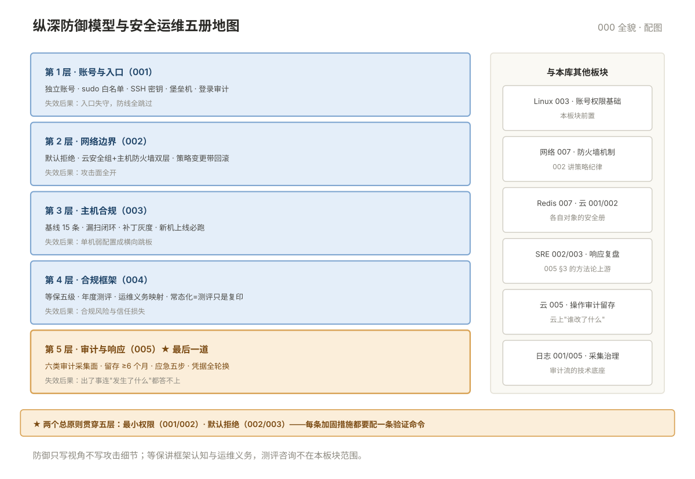

# 000 安全运维全貌

> **这一册回答**：安全运维板块管什么、纵深防御怎么分层、五册怎么分工、哪些内容在别的板块。10 分钟读完装进一张地图。  
> **给谁读**：负责主机与系统安全的运维/SRE；准备等保测评的团队。位于五阶段第五段（方法收口）。

## 板块地图

五册对应纵深防御五层：**账号与入口（001）→ 网络边界（002）→ 主机合规（003）→ 合规框架（004）→ 审计与响应（005）**。

| 册 | 一句话 | 回答的问题 |
|---|---|---|
| [001 账号与 SSH 加固](001-账号与SSH加固.md) | 入口收窄 | 账号生命周期、sudo 授权、SSH 加固、登录审计 |
| [002 防火墙与访问控制](002-防火墙与访问控制策略.md) | 边界收窄 | 默认拒绝、策略变更流程、云安全组双层 |
| [003 基线与漏洞扫描](003-基线与漏洞扫描.md) | 主机合规 | 基线核查、漏扫工具、修复优先级 |
| [004 等保框架认知](004-等保框架认知.md) | 合规框架 | 五级、运维义务、测评项映射 |
| [005 日志审计与应急响应](005-日志审计与应急响应.md) | 检测与响应 | 审计采集面、留存合规、应急五步 |
| [00 术语表](00-术语表.md) | 词汇 · 缩写 · 易混对 · 症状反查 | 按主题分组 |

纵深防御模型与五册位置：

## 核心概念速览

- **最小权限是一切的总原则**：账号、sudo、防火墙、ACL——每层都只给"完成所必需"的权限（001/002）。
- **默认拒绝**：防火墙策略只放行明确允许的——白名单思维贯穿所有访问控制。
- **加固要有验证**：每条措施都配验证命令——没有验证的加固等于没做（003）。
- **审计是最后的防线**：前四层全被绕过时，审计日志是唯一还能回答"发生了什么"的（005）。
- **安全是流程不是状态**：加固一次不等于永远安全——基线复核、漏扫、演练是周期性动作（003/005）。

## 与相邻板块的分界

| 问题 | 去哪 |
|---|---|
| 账号与权限的基础概念（SUID/ACL 细节） | 「Linux」003——本板块 001 是运维纪律深化 |
| iptables/nftables 的机制原理 | 「网络」007——本板块 002 是策略管理纪律 |
| Redis/云主机的各自安全配置 | 「Redis」007 · 「云平台」001/002 |
| 制品与流水线安全（不可变制品） | 「CICD」006 |
| 入侵后的技术复盘 | 「SRE」003——本板块 005 只讲应急流程 |
| 攻击技术、渗透测试方法论 | 超出防御视角，不写 |

## 学习路径

- **顺序读**：000 → 001 → 002 → 003 → 004 → 005。
- **按任务进**：新机上线加固 → 001+003；等保准备 → 004；被入侵处置 → 005；防火墙策略梳理 → 002。
- **前置**：Linux 003（账号与权限基础）与网络 007（防火墙机制）是本板块的地基——先读再进。

## 误解澄清

| # | 误解 | 事实 |
|---|---|---|
| 1 | 在内网就不用加固 | 横向移动正是从内网一台沦陷开始的 |
| 2 | 装了杀软/防火墙就安全 | 单层防线必被绕过——纵深防御是叠加 |
| 3 | 加固做一次就完 | 系统在变、漏洞在出——基线与漏扫是周期动作 |
| 4 | 等保是买产品凑分 | 测评查的是"义务是否落实"，运维动作是主体 |
| 5 | 日志随便放本机 | 未集中留存=审计失效+合规不过（005） |
| 6 | 安全只是安全团队的事 | 账号、补丁、日志、应急的第一响应人都是运维 |

---

**下一篇**：[001 账号与 SSH 加固](001-账号与SSH加固.md) —— 从入口收窄开始。
