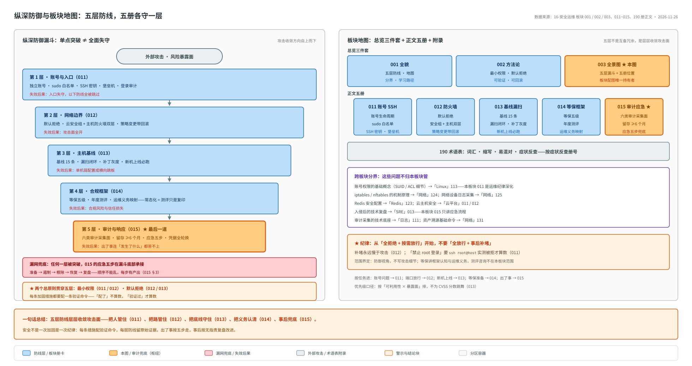

# 安全全景图

> **这一册回答**：安全运维板块 5 册在纵深防御五层上的位置，一张图看清。
> **怎么用**：看图定层，再回 [001-安全运维全貌](001-安全运维全貌.md) 选册。

## 体系一张图

## 图例说明

| 层 | 册 | 防御段 |
| --- | --- | --- |
| 总览三件套 | 001 / 002 / 003 | 全貌 · 方法论 · 本图 |
| 身份层 | 011 | 账号生命周期、sudo、SSH——把人管住 |
| 网络层 | 012 | 防火墙与安全组——把路管住 |
| 系统层 | 013 | 基线与漏扫——把底线守住 |
| 合规层 | 014 | 等保框架——把义务认清 |
| 审计层 | 015 | 日志审计与应急——事后兜底 |
| 附录 | 190 | 术语 · 缩写 · 易混对 · 症状反查 |

图中漏斗自上而下是**攻击收敛方向**：任何一层被突破，下一层继续收敛攻击面——五层不是互备冗余，是让单点突破不至于变成全面失守。应急五步（015）在漏斗底部承接所有漏网情况。

---

**上一篇**：[002-安全方法论](002-安全方法论.md)　**下一篇**：正文 [011-账号与SSH加固](011-账号与SSH加固.md)
