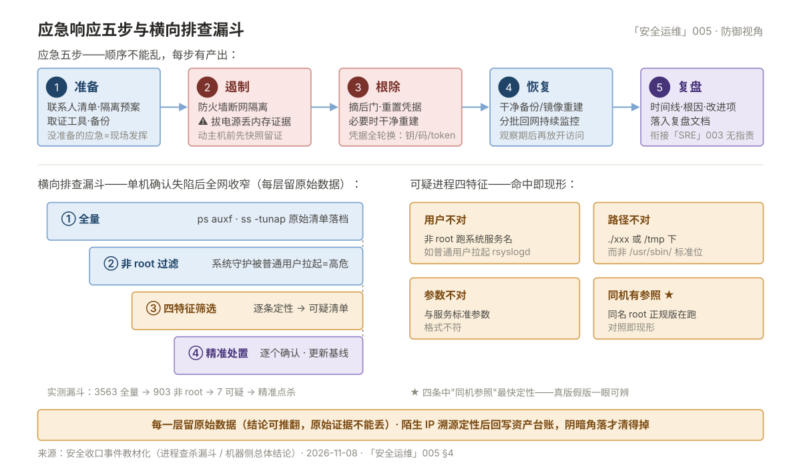

# 005 日志审计与应急响应

> **解决**：检测与响应的最后一层——审计日志采集面与留存合规、入侵事件的应急五步。  
> **范围**：审计采集面 · 留存合规 · 应急响应五步 · 演练入门。  
> **口径**：防御视角的流程与留存纪律；攻击细节与取证工具深入不写（SRE 003 讲复盘方法）。

## 目录

| 节 | 内容 |
|---|---|
| 1 | 审计日志的采集面 |
| 2 | 留存合规与集中化 |
| 3 | 应急响应五步 |
| 4 | 简易处置手册：被入侵的机器 |
| 5 | 坑表 |
| 6 | 检查清单 |

---

## 1. 审计日志的采集面

审计日志要能回答"**谁、何时、从哪、干了什么**"——采集面按这个目标配齐：

| 来源 | 回答什么 | 采集方式 |
|---|---|---|
| auth.log / secure | 登录成功/失败、sudo 使用 | rsyslog 集中转发（「日志」001） |
| auditd | 系统调用级：文件改动、命令执行、权限变更 | `auditctl` 规则（watch /etc/passwd 等） |
| 命令历史 | 用户操作轨迹 | history + sudo.log（001 §2） |
| 应用与中间件 | 业务操作与异常 | 统一日志采集（「日志」001） |
| 云操作审计 | 控制台/API 谁改了什么 | ActionTrail（015 005 §2） |
| 网络设备/防火墙 | 边界连接记录 | syslog/SNMP（「网络」008） |

采集面纪律：**时间先同步（NTP），再谈审计**——没有统一时钟的日志无法串联时间线（001 的 NTP 基线项）。

## 2. 留存合规与集中化

**留存要求**：等保与网安法要求日志留存 **≥6 个月**（测评硬项，004 §4）；安全事件的取证窗口往往更长——**集中化 + 长存**是标准答案：

| 纪律 | 做法 |
|---|---|
| 集中采集 | 各机 rsyslog 转发到中心（本机日志可被篡改——集中副本才是证据） |
| 长期留存 | 中心日志推 OSS 冷归档（015 003 §3 生命周期），≥6 个月起步 |
| 权限隔离 | 审计日志只读——运维可写业务日志，但不可改审计流 |
| 完整性 | 高危场景上哈希/链式签名（视合规级别） |

## 3. 应急响应五步

发现入侵（或疑似）后的组织化处置——**顺序不能乱，每步有产出**：

| 步 | 动作 | 关键纪律 |
|---|---|---|
| ① 准备 | 平时建好：联系人清单、隔离预案、取证工具、备份 | 没有准备的应急是现场发挥 |
| ② 遏制 | 断网隔离（⚠️ 防火墙切断而非拔电源——保留内存证据） | 先止损再查因；动主机前先快照留证 |
| ③ 根除 | 摘除后门/重置凭据/打补丁——**必要时重装系统**（"干净重建"优于"精确清除"） | 凭据全部轮换：SSH 密钥、密码、API token |
| ④ 恢复 | 从干净备份/镜像重建，分批回网并持续监控 | 观察期后再恢复正常访问 |
| ⑤ 复盘 | 时间线、根因、改进项——**落入复盘文档**（衔接「SRE」003） | 无指责复盘（「SRE」003 同口径） |

**第一响应纪律**：发现被入侵**先报告再动手**——个人处置容易破坏证据链；时间线（谁/何时/从哪/做了什么）是取证的骨架，动作前先截图与导出日志。

## 4. 简易处置手册：被入侵的机器

⚠️ 以下命令在**隔离后**执行（②遏制完成），顺序即取证顺序：

```bash
# 1. 留证：内存与进程现场（隔离后尽快）
ps auxf > /tmp/ir/ps.txt; ss -tunap >> /tmp/ir/ps.txt
cp /var/log/auth.log /var/log/audit/audit.log /tmp/ir/

# 2. 排查：谁在登录、什么在跑、改了什么
last | head -30                              # 登录历史
crontab -l; ls -la /etc/cron*                # 定时任务后门
systemctl list-unit-files --state=enabled    # 可疑服务
find / -mtime -3 -type f -perm -o+x 2>/dev/null | head   # 近 3 天新可执行
cat /root/.ssh/authorized_keys               # 被塞入的公钥

# 3. 处置：按 ③ 根除执行（重装优先），凭据全轮换（001 §1）
```

**可疑特征对照**：陌生 IP 登录成功、CPU 异常满（挖矿）、crontab 出现陌生条目、`authorized_keys` 多出公钥、systemd 里多出无名服务——命中即按五步走。

**全网横向排查：漏斗法**（坑表第 3 条的落地动作）。单机确认失陷后，同特征排查按漏斗收窄，**每一层留原始数据**（011 的原始数据/结论分层——结论可推翻，原始清单不能丢）：

| 层 | 动作 | 产出 |
|---|---|---|
| ① 全量 | 全网采集 `ps auxf`、`ss -tunap` | 原始清单落档 |
| ② 过滤 | 非 root 用户进程（系统守护被普通用户拉起 = 高危信号） | 数量 + 清单 |
| ③ 特征 | 按四特征筛可疑（见下） | 可疑清单 |
| ④ 处置 | 逐个确认后精准处置，更新对照基线 | 处置记录 |

**可疑进程四特征**：**用户不对**（非 root 跑着系统服务名，如普通用户拉起 rsyslogd）；**路径不对**（当前目录 `./xxx`、/tmp 下，而非 `/usr/sbin/` 标准位置）；**参数不对**（与该服务标准参数格式不符）；**同机有参照**（同名进程的 root 正规版还在正常跑——对照即现形）。真实案例里一个伪装 rsyslogd 的进程，四条中了三条，唯独靠"同机参照"一眼定性。

五步主链、漏斗收窄与四特征的完整形态见下图——一屏收拢本节的全部动作：



**阴暗角落清零：不可控资产溯源**。网段扫描总会扫出"不认识的 IP"——按五类溯源到资产，**全部可解释才算收口**：硬件管理卡（IDRAC 类，非 OS，Web 管控）/ 无法 SSH 的 Windows 终端 / 已下线但仍存活 / 特殊网络形态（与节点同 MAC、同交换机端口即 VIP 成对；容器静态 IP 沿宿主机 OVS 桥拓扑下钻）/ 无服务的备用机。溯源手段就是「网络」009 的基础命令：MAC/ARP 表、拓扑下钻、端口特征判角色。**溯源完必须回写资产台账**（标记管理卡、已下线），否则下次扫描把同一批 IP 再怀疑一遍——阴暗角落永远清不掉。

## 5. 坑表

| # | 坑 | 后果 | 正确做法 |
|---|---|---|---|
| 1 | 发现入侵立即拔电源/重装 | 证据链丢失，根因不明 | 先遏制（断网）+留证，再根除 |
| 2 | 只清后门不轮换凭据 | 攻击者用旧密钥再次进入 | 凭据全量轮换（001） |
| 3 | 应急只看单台机器 | 攻击者已横向移动 | 全网排查同特征 |
| 4 | 日志只在本机 | 攻击者清日志=无据可查 | 集中采集（§1） |
| 5 | 事后不复盘不改进 | 同样手法二次中招 | ⑤ 复盘落入「SRE」003 文档 |
| 6 | 可疑进程只看 CPU 与名字 | 伪装成系统服务名、低 CPU 的进程漏网 | 四特征判定：用户/路径/参数/同机参照（§4） |
| 7 | 横向排查一次全表人工翻 | 数千条看不完，真后门藏在漏翻的那段 | 漏斗收窄：全量→非 root→特征→处置，每层留档（§4） |
| 8 | 扫描出的陌生 IP 查完就忘 | 下次扫描重复怀疑，阴暗角落永远在 | 五类溯源定性后回写资产台账（§4） |

## 6. 检查清单

| # | 问题 |
|---|---|
| 1 | 六类审计采集面都配了吗？NTP 同步了吗？ |
| 2 | 日志集中留存 ≥6 个月做到了吗？ |
| 3 | 应急五步能背出来吗？① 准备的东西实际存在吗？ |
| 4 | 被入侵的第一反应是"报告+留证"而不是"先删了再说"吗？ |
| 5 | 凭据轮换清单（SSH/密码/token）准备好了吗？ |
| 6 | 应急演练做过吗（哪怕是桌面推演）？ |
| 7 | 横向排查的漏斗四层能落地吗？扫描出的陌生 IP 回写资产台账了吗？ |

---

**回到**：[安全运维板块总览](README.md) —— 五册完结，回到板块导航。
