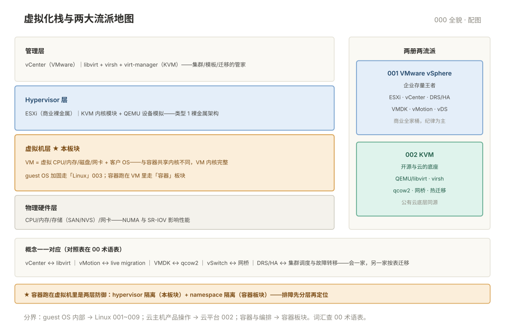

# 000 虚拟化全貌

> **这一册回答**：虚拟化板块管什么、两大流派怎么选、两册怎么分工、什么问题不归虚拟化管。10 分钟读完装进一张地图。  
> **给谁读**：管理企业虚拟化环境的运维；容器运维想搞懂底层的工程师。位于五阶段第三段（平台与交付）——虚拟化是容器与云主机的地基。

## 板块地图

两册两大流派，**概念一一对应、工具不同**：

| 册 | 一句话 | 回答的问题 |
|---|---|---|
| [001 VMware vSphere 运维](001-VMwarevSphere运维.md) | 企业存量王者 | ESXi/vCenter 架构、虚拟机生命周期、快照纪律、DRS/HA |
| [002 KVM 运维](002-KVM运维.md) | 开源与云上的底座 | libvirt/virsh、虚拟机 XML、网络存储、热迁移 |
| [003 PVE 运维](003-PVE运维.md) | 开箱即用的打包平台 | 集群与 pmxcfs、IP→宿主机映射、API 优先、卡死处置 |
| [00 术语表](00-术语表.md) | 词汇 · 缩写 · 易混对 · 症状反查 | 按主题分组 |

虚拟化栈与三册的位置：

## 核心概念速览

- **hypervisor 分两类**：类型 1 裸金属（ESXi/KVM——生产标准）；类型 2 宿主上（Workstation——桌面用）。
- **虚拟机 vs 容器**：VM 有完整虚拟内核（隔离重、启动慢、占资源多）；容器共享宿主内核（轻快）——**容器通常跑在 VM 里**，两层防御。
- **快照不是备份**：快照是链式差分（依赖母盘），备份是独立副本——"有快照所以不用备份"是最贵的一课（001 §2）。
- **超分是双刃剑**：内存/CPU 分出去的比物理的多（利用率高），但"所有 VM 同时要资源"时会互相挤—— ballooning 与准入控制是安全阀。
- **迁移是虚拟化的杀手锏**：在线把运行中的 VM 搬到另一台宿主机（vMotion/live migration）——硬件维护不停机。

## 与相邻板块的分界

| 问题 | 去哪 |
|---|---|
| 容器与编排（Docker/K8s） | 「容器」板块——它们跑在本板块的 VM 里 |
| 云主机（ECS/EC2）的产品操作 | 「云平台」002——云主机就是托管虚拟机，KVM 概念通用 |
| 主机系统内部（账号/服务/性能） | 「Linux」001~009——guest 里的 OS 归 Linux 板块 |
| 网络的协议层排障 | 「网络」板块——本板块只到虚拟交换机这一层 |
| 存储硬件（SAN/NAS 阵列） | 建议单独成文——本板块只到 Datastore/存储池 |

## 学习路径

- **只管 VMware 环境**：000 → 001。
- **只管 KVM/开源环境**：000 → 002（001 的概念仍建议通读——对照表帮你迁移经验）。
- **只管 PVE**：000 → 003（002 的 KVM 概念是它的底座）。
- **都要管**：000 → 001 → 002 → 003，重点做各册的对照表（术语映射）。
- **按任务进**：快照/磁盘满 → 001 §2/§4；新建 VM → 002 §3；找宿主机/卡死处置 → 003 §3/§6；迁移 → 各册迁移节；资源告警 → 各册资源节。

## 误解澄清

| # | 误解 | 事实 |
|---|---|---|
| 1 | 有快照就不用备份 | 快照链依赖母盘——母盘坏全坏；备份才是独立副本 |
| 2 | 虚拟化过时了，都是容器的时代 | 容器跑在 VM 里；企业存量 VM 只多不少 |
| 3 | 内存超分随便开 | 全部 VM 真实用满时互相挤压——准入控制与告警必须配 |
| 4 | KVM 性能不如 VMware | KVM 是公有云的底座（AWS EC2 底层就有 KVM），性能取决于配置 |
| 5 | VM 里的系统不用做安全加固 | guest OS 加固（「Linux」003）与 hypervisor 加固是两层 |
| 6 | CPU 超分比 = vCPU 数配平即可 | 还要看 NUMA 与实际负载特征，盲目超分引入调度延迟 |

---

**下一篇**：[001 VMware vSphere 运维](001-VMwarevSphere运维.md) —— 企业存量环境的王者。
