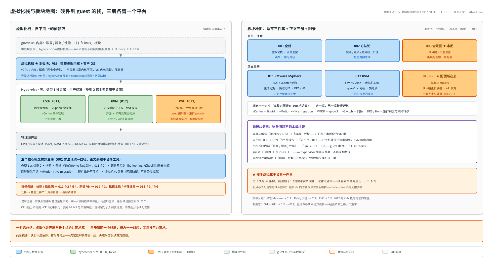

# 虚拟化全景图

> **这一册回答**：虚拟化板块 3 册在虚拟化栈上的位置，一张图看清。
> **怎么用**：看图定平台，再回 [001-虚拟化全貌](001-虚拟化全貌.md) 选册。

## 体系一张图

## 图例说明

| 栈层 | 册 | 管什么 |
| --- | --- | --- |
| 总览三件套 | 001 / 002 / 003 | 全貌 · 方法论 · 本图 |
| 企业存量平台 | 011 | ESXi/vCenter：虚拟机生命周期、快照纪律、DRS/HA |
| 开源底座 | 012 | libvirt/virsh：XML、虚拟网络存储、热迁移 |
| 开箱即用平台 | 013 | PVE：集群与 pmxcfs、IP→宿主机映射、卡死处置 |
| 附录 | 190 | 术语 · 缩写 · 易混对 · 症状反查 |

图中栈自下而上是**依赖方向**：硬件 → hypervisor → 虚拟机 → guest OS。三册各管一个 hypervisor 平台，栈的位置相同、工具不同——同一概念（快照/迁移/超分）在 002 方法论里统一，在正文册里按平台落工具。guest OS 之上归「Linux」板块，容器层归「容器」板块——本板块是它们共同的地基。

---

**上一篇**：[002-虚拟化方法论](002-虚拟化方法论.md)　**下一篇**：正文 [011-VMwarevSphere运维](011-VMwarevSphere运维.md)
