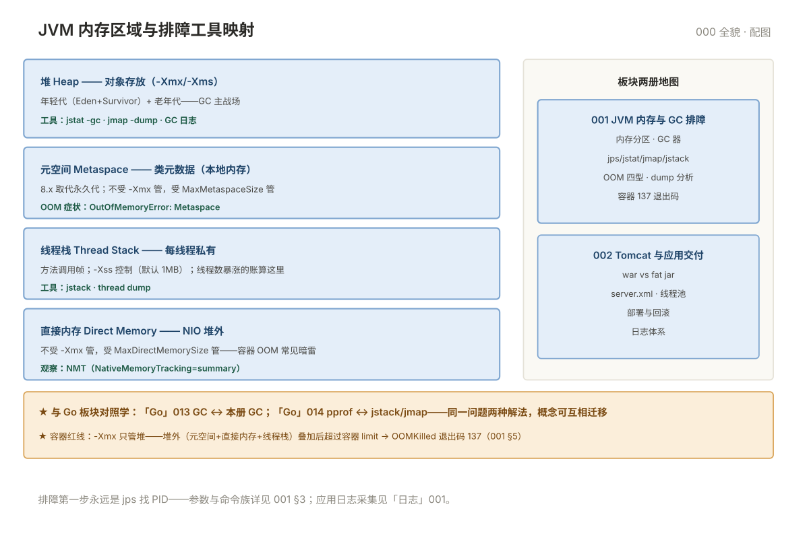

# 000 Java 应用全貌

> **这一册回答**：运维手里的 Java 应用长什么样、JVM 内存怎么分、两册怎么分工、与 Go 板块的对照。10 分钟读完装进一张地图。  
> **给谁读**：接手 Java 应用（Spring Boot/Tomcat/存量 war）的运维/SRE。位于五阶段第四段（中间件与观测）。

## 板块地图

两册一条主线：**001 懂 JVM 这台"机器"（内存/GC/排障）→ 002 管应用的交付（Tomcat/fat jar/部署）**。

| 册 | 一句话 | 回答的问题 |
|---|---|---|
| [001 JVM 内存与 GC 排障](001-JVM内存与GC排障.md) | Java 进程"内存+卡顿"的完整排障 | 内存分区、GC 器、jstat/jmap/jstack、OOM 四型 |
| [002 Tomcat 与应用交付](002-Tomcat与应用交付.md) | 应用怎么交付、怎么回滚 | war/fat jar、Tomcat 配置、部署流程 |
| [00 术语表](00-术语表.md) | 词汇 · 缩写 · 易混对 · 症状反查 | 按主题分组 |

JVM 内存区域与排障工具映射：

## 核心概念速览

- **JVM = 应用之下的"机器"**：你管的不是操作系统直接跑的业务，而是 JVM 进程里跑的字节码——参数（-Xmx）与工具（jstack）都在这一层。
- **内存四区分管不同 OOM**：堆（对象）/元空间（类元数据）/线程栈（调用帧）/直接内存（NIO 堆外）——**报错信息指明区域，处理方式完全不同**（001 §4）。
- **GC 是延迟抖动的常客**：STW 暂停毫秒到秒级——GC 日志是判断"慢是不是 GC 引起"的第一证据。
- **两种交付形态**：war 部到外置 Tomcat；fat jar 自带容器 `java -jar`（Spring Boot 主流）——部署与回滚方式完全不同（002）。
- **容器里的 Java 有特有坑**：容器内存 limit 与 JVM 堆外内存叠加导致 OOMKilled（退出码 137）——001 §5。

## 与相邻板块的分界

| 问题 | 去哪 |
|---|---|
| Go 程序的 GC 与 pprof | 「Go」013/014——GC 是同一问题的两种解法，对照着学 |
| JVM 指标进 Prometheus | 「监控」007（JMX exporter/Micrometer）· 001 §3 |
| 应用日志的采集与治理 | 「日志」001/005——Java 应用日志（logback）是采集对象 |
| 部署流水线（war/jar 的 CI 发布） | 「CICD」007/008 |
| 数据库连接池背后的数据库 | 「数据库」板块——连接池只是客户端 |

## 学习路径

- **顺序读**：000 → 001 → 002。
- **救火直达**：OOM → 001 §4；CPU 高 → 001 §3；启动失败 → 002 §4。
- **对照学**：Go 013 GC ↔ 本板块 001；Go 014 pprof ↔ jstack/jmap——**同一问题的两国语言**。

## 误解澄清

| # | 误解 | 事实 |
|---|---|---|
| 1 | Java 慢 = 加内存 | 先分清堆/元空间/泄漏——盲目加内存掩盖泄漏 |
| 2 | 重启解决一切 OOM | 泄漏型 OOM 过几天再来——dump 对比找增长点 |
| 3 | -Xmx 设成容器 limit 就安全 | 堆外（元空间/直接内存/线程栈）不在 -Xmx 里——总量会超 limit（001 §5） |
| 4 | GC 日志开了影响性能 | 开销极小（especially 8+ 统一日志），生产必开 |
| 5 | Tomcat 线程越多越好 | 线程切换与数据库连接数才是瓶颈——按压测定 |
| 6 | dump 文件很大打不开就放弃 | MAT 支持分块分析；或先用 jmap -histo 看直方图 |

---

**下一篇**：[001 JVM 内存与 GC 排障](001-JVM内存与GC排障.md) —— Java 进程的内存地图与排障命令族。
