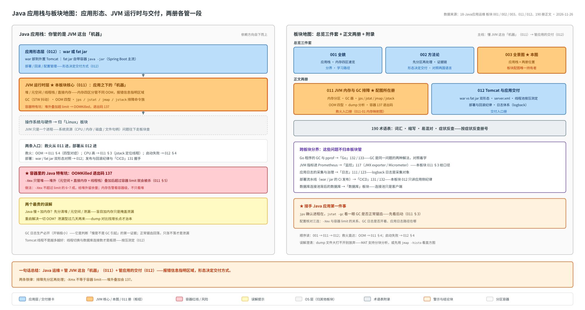

# Java 全景图

> **这一册回答**：Java 应用运维板块 2 册的分工，一张图看清。
> **怎么用**：看图定册，再回 [001-Java应用全貌](001-Java应用全貌.md) 选入口。

## 体系一张图

## 图例说明

| 层 | 册 | 管什么 |
| --- | --- | --- |
| 总览三件套 | 001 / 002 / 003 | 全貌 · 方法论 · 本图 |
| 运行时层 | 011 | JVM 内存分区、GC 与抖动、排障命令族、OOM 四型、容器特有坑 |
| 交付层 | 012 | war/fat jar 双形态、Tomcat 配置、部署与回滚纪律 |
| 附录 | 190 | 术语 · 缩写 · 易混对 · 症状反查 |

图中自上而下是**依赖方向**：应用形态（012）决定它怎么被交付，运行时（011）决定它出事时往哪查。救火从 011 的 OOM 四型进，部署从 012 的双形态对照进；栈底操作系统层归「Linux」板块。对照学习的另一国语言在「Go」132/133。

---

**上一篇**：[002-Java方法论](002-Java方法论.md)　**下一篇**：正文 [011-JVM内存与GC排障](011-JVM内存与GC排障.md)
