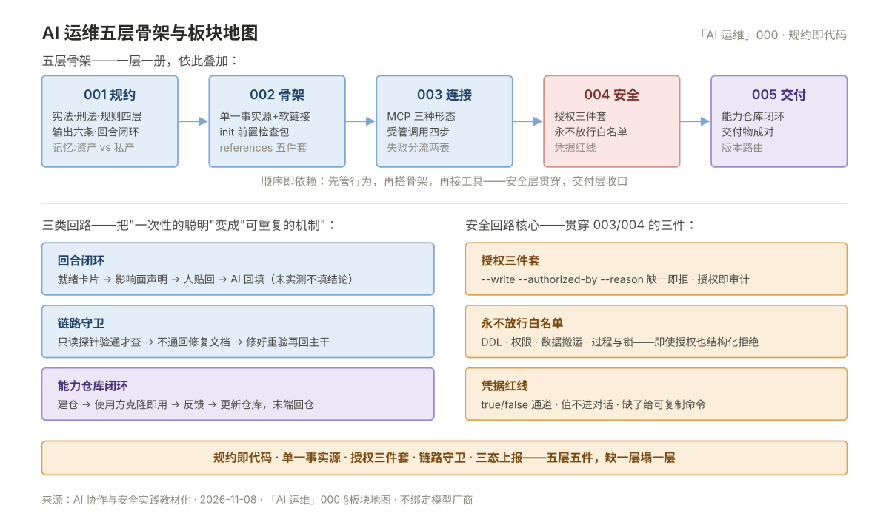

# 000 AI 运维全貌

> **一句话**：AI 运维工程化 = 把 AI 的**行为、技能、连接、授权、交付**五件事全部工程化——本板块是它们的地图，每册一层。  
> **读者**：用 AI 干运维、吃过"每次都要重新交代规矩"亏的运维；想知道"别人家 AI 为什么像同事、我的像玩具"。  
> **阶段**：方法收口之后的**演进层**——前置是「SRE」002（变更纪律）与「CICD」（仓库协作）。

## 板块地图

| 册 | 一句话 | 回答的问题 |
|---|---|---|
| [001 AI 协作规约](001-AI协作规约.md) | 行为层：规约四层效力 + 输出六条 + 回合闭环 | AI 的行为怎么约束、产出长什么样 |
| [002 Harness 与技能工程](002-Harness与技能工程.md) | 骨架层：单一事实源 + init 检查包 + references | 技能放哪、怎么挂、开工体检谁做 |
| [003 MCP 接入与受管调用](003-MCP接入与受管调用.md) | 连接层：MCP 三形态 + 受管四步 + 失败分流 | AI 怎么连数据与系统，失败了怎么办 |
| [004 AI 批量操作安全](004-AI批量操作安全.md) | 安全层：授权三件套 + 永不放行 + 凭据红线 | 危险动作怎么授权怎么留痕 |
| [005 AI 服务化交付](005-AI服务化交付.md) | 交付层：能力仓库闭环 + 版本路由 | 能力怎么变成团队产品 |

## 核心概念速览

- **规约即代码**：规矩长在仓库里随版本管理，不在会话口头——换会话、换工具、换人都成立。
- **单一事实源**：技能/规约/记忆各只有一份权威，其余全是软链接或引用。
- **授权三件套**：写操作 = `--write --authorized-by --reason` 缺一即拒，授权即审计。
- **链路守卫**：先探针验链路再干活，不通先修不硬查。
- **三态上报**：AI 汇报只说成功/失败/受阻——受理不等于成功。

## 相邻板块分界

| 谁管 | 不管 | 误归属澄清 |
|---|---|---|
| 「SRE」002：人与系统的变更纪律 | AI 这个"新同事"的用工纪律 | AI 违规复盘仍走 SRE 复盘，用工规约在本板块 001 |
| 「数据库」册：SQL 与库运维本身 | AI 连库的凭据与授权通道 | 凭据红线在 004，不在数据库册 |
| 「CICD」011：镜像仓库 | AI 能力仓库（规约+技能+文档） | 形态同源内容不同，别共用一个仓 |
| 「容器」册：K8s 对象操作 | GitOps 之外 AI 的部署动作 | AI 不直接改生产，走既有变更通道 |

## 学习路径

- **顺序读**：000 → 001 → 002 → 003 → 004 → 005——五层依此叠，跳层会缺直觉。
- **按角色进**：只想管住 AI 行为 → 001；要搭团队技能库 → 002；要接数据 → 003；上生产前 → 004；要交付给团队 → 005。
- **按症状进**：见 [00 术语表](00-术语表.md) 症状反查表。

## 误解澄清

| # | 误解 | 实际 |
|---|---|---|
| 1 | AI 运维 = 学 prompt 技巧 | 规约、骨架、连接、授权、交付五层工程，prompt 只是最表层 |
| 2 | 规约写进系统提示词就够了 | 提示词跟会话走；进仓库才随版本管理与团队分发 |
| 3 | 技能复制到各工具目录最稳 | 单一事实源 + 软链接；复制必分叉 |
| 4 | AI 很聪明不用前置检查 | 检查包防的是环境与配置，不是智力 |
| 5 | AI 能自己判断该不该写库 | 判定是人的：三件套缺一即拒 |
| 6 | 授权一次可以覆盖一批操作 | 白名单外即使授权也结构化拒绝 |
| 7 | MCP 就是插件市场 | 协议 + 能力索引；索引没有的能力不存在 |
| 8 | 失败重试总能解决 | 403 换入口绕过 = 审计断裂；按分流表走 |
| 9 | AI 产出直接入库 | 成对交付：数据 + 交接文档，可复核才收 |
| 10 | AI 项目做完就结束 | 闭环末端回仓库——能力随使用迭代 |

---

> 下一篇：《001 AI 协作规约》——五层的第一层：行为怎么管。
