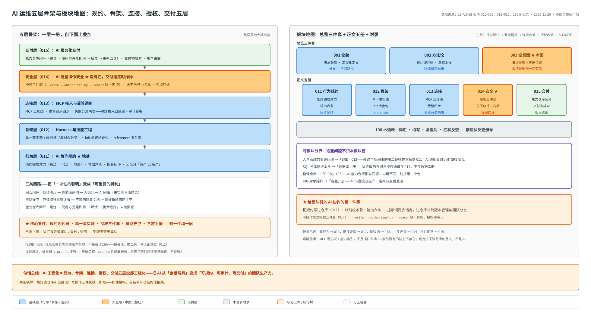

# AI 全景图

> **这一册回答**：AI 运维板块 5 册在「AI 工程化」五层骨架上的位置，一张图看清。
> **怎么用**：看图定层，再回 [001-AI运维全貌](001-AI运维全貌.md) 选册。

## 体系一张图

## 图例说明

| 层 | 册 | 管什么 |
| --- | --- | --- |
| 总览三件套 | 001 / 002 / 003 | 全貌 · 方法论 · 本图 |
| 行为层 | 011 | AI 协作规约：四层效力 + 输出六条 + 回合闭环 |
| 骨架层 | 012 | Harness 与技能工程：单一事实源 + init 检查包 + references |
| 连接层 | 013 | MCP 接入与受管调用：三形态 + 受管四步 + 失败分流 |
| 安全层 | 014 | AI 批量操作安全：授权三件套 + 永不放行 + 凭据红线 |
| 交付层 | 015 | AI 服务化交付：能力仓库闭环 + 版本路由 |
| 附录 | 190 | 术语 · 缩写 · 易混对 · 症状反查 |

图中五层自下而上是**叠加顺序**：行为管住（011）→ 骨架搭好（012）→ 连接收敛（013）→ 授权收紧（014）→ 交付成环（015）——跳层落地会缺地基：没有规约的连接是裸奔，没有授权的交付是定时炸弹。五层共同把 AI 从「会话玩具」变成「可规约、可审计、可交付」的团队生产力。

---

**上一篇**：[002-AI方法论](002-AI方法论.md)　**下一篇**：正文 [011-AI协作规约](011-AI协作规约.md)
